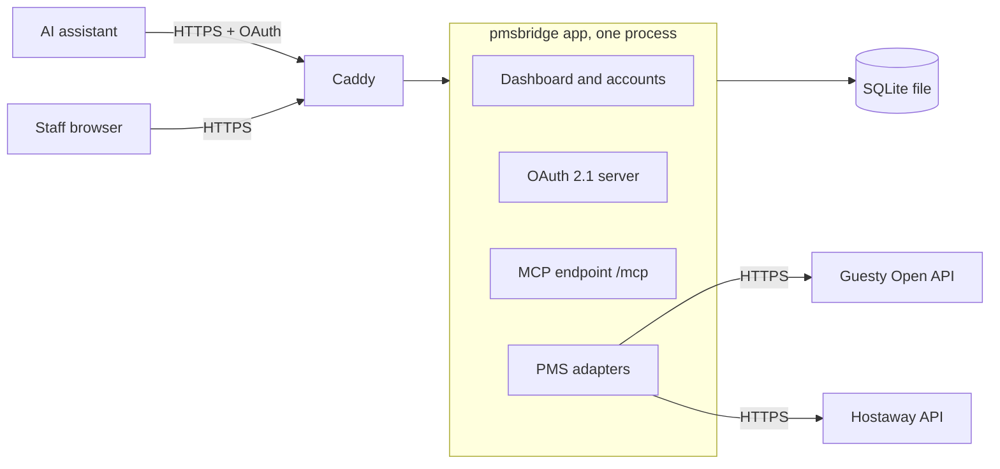

# Architecture

## Components

| Package | Responsibility |
|---|---|
| `pmsbridge.core` | Settings, storage, encryption, logging, metrics |
| `pmsbridge.accounts` | Users, invites, roles, sessions, two-factor auth, dashboard |
| `pmsbridge.oauth` | OAuth 2.1 authorization server used by AI clients |
| `pmsbridge.mcp` | MCP endpoint, token verification, tools |
| `pmsbridge.pms` | Provider contract, canonical models, Guesty and Hostaway adapters |

## Request flow for a tool call

1. The AI client calls `/mcp` with a bearer token issued by the pmsbridge OAuth server.
2. The token is looked up by its hash and checked (expiry, revocation, audience, the person is still
   active). It names the person, the assistant and the PMS connections that were approved.
3. The tool checks that the requested connection is allowed, that the provider supports the capability,
   and, for actions that change data, that an admin has enabled write actions for that connection.
4. The provider adapter calls the PMS API (with shared rate limiting and a cached PMS token) and maps the
   response to canonical models.
5. The result is returned to the AI client, and an audit entry is recorded without payload contents.

Every tool goes through one framework that, in order, builds the call context from the token, resolves the
connection, refuses connections that are turned off or need attention, checks that a provider-specific
tool matches the connection's provider, checks that changes are allowed for write tools, then loads the
provider and checks the capability, sets a 25-second deadline, maps PMS errors to safe messages, caps the
result size and writes the audit entry. A background task in the single application process deletes audit entries older than
`AUDIT_RETENTION_DAYS`.

See the design decisions in [adr/](adr/0001-architecture-overview.md).
