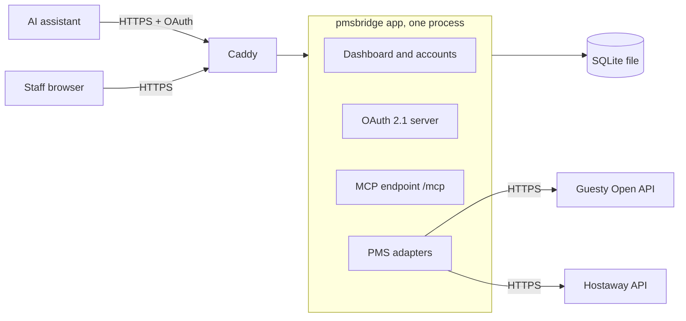

# Architecture

## Components

| Package | Responsibility |
|---|---|
| `pmsbridge.core` | Settings, storage, encryption, logging, metrics |
| `pmsbridge.accounts` | Users, invites, roles, sessions, two-factor auth, dashboard |
| `pmsbridge.oauth` | OAuth 2.1 authorization server used by AI clients |
| `pmsbridge.mcp` | MCP endpoint, token verification, tools |
| `pmsbridge.pms` | Provider contract, canonical models, Guesty and Hostaway adapters |

## Request flow for a tool call

1. The AI client calls `/mcp` with a bearer token issued by the pmsbridge OAuth server.
2. The token is verified (signature, audience, expiry, revocation). It names the user and the PMS
   connections that user allowed.
3. The tool checks that the requested connection is allowed, that the provider supports the capability,
   and, for actions that change data, that an admin has enabled write actions for that connection.
4. The provider adapter calls the PMS API (with shared rate limiting and a cached PMS token) and maps the
   response to canonical models.
5. The result is returned to the AI client, and an audit entry is recorded without payload contents.

See the design decisions in [adr/](adr/0001-architecture-overview.md).
